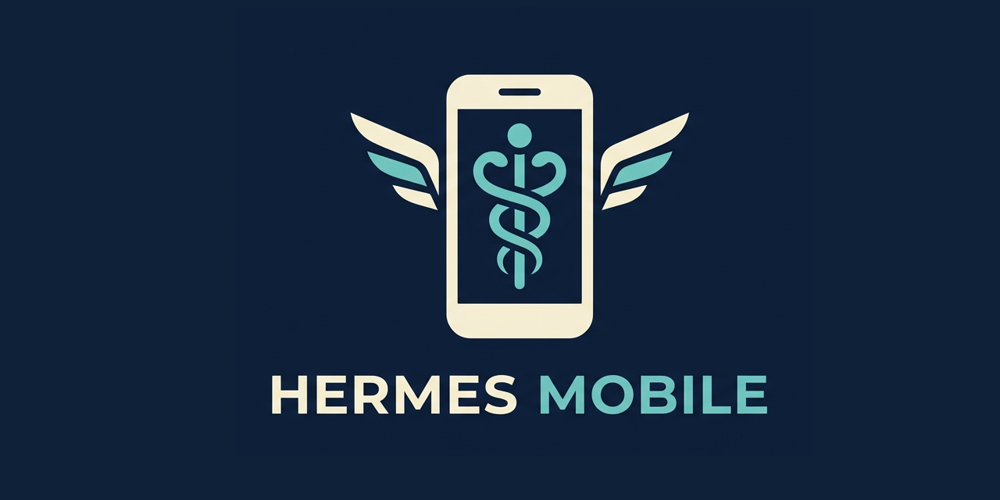

# hermes-mobile

<p align="center"></p>

Phone view for Hermes Desktop on Windows. Read the Bot Chat of each Hermes bot,
switch bots, and send text from a phone over a private network (Tailscale).

It is a small local server. It does not change Hermes itself and it does not
write to the Hermes databases.

## What it does

- **Read:** shows the newest 120 messages of each bot's Bot Chat, read from `state.db` (read-only).
- **Switch:** clicks the bot's button in the Hermes Desktop sidebar via Windows UI Automation.
- **Write:** pastes the text into the Hermes Desktop window and presses Enter. Only allowed for the bot that is currently active in the desktop.

The Hermes Desktop app stays the only writer to the sessions.

## Bot discovery

Every Hermes profile with desktop sessions is one bot:

- the default profile is `hermes`
- a named profile `x` is `x`
- label = the id in Title Case (`elite-coder` → "Elite Coder")
- sidebar button = `@<id>`

To override any of this, use `bots` in `config.json`:

```json
"bots": {
  "elite-coder": { "label": "Coder", "ui_name": "@elite-coder" }
}
```

`HERMES_HOME` is respected. Default: `%LOCALAPPDATA%\hermes`.

## Requirements

- Windows 10/11 with PowerShell
- Hermes Desktop, open and not minimized
- Python 3 (standard library only)
- Tailscale on the PC and on the phone

## Setup

1. Clone the repo, e.g. to `C:\Temp\hermes-mobile`.
2. Run the setup once:
   ```
   python server.py --init
   ```
   This writes `config.json` with the PC's Tailscale IP (`tailscale ip -4`),
   creates `token.txt`, and prints the phone URL. Without Tailscale, pass the
   IP yourself: `python server.py --init --host <private-ip>`.
3. Start the tray app (or double-click `hermes-mobile.exe`):
   ```
   hermes-mobile.exe
   ```
   The tray icon shows the status: green = server and desktop window ok, yellow = server ok but no desktop window, red = server stopped. Menu: restart, reconnect (re-checks the Tailscale IP), copy URL, open log, autostart at login, quit, and the version.

   Without the exe: `python server.py` runs the server only, without tray icon.
4. On the phone, open the URL from step 2: `http://<ip>:8765/?t=<token>`

## Security notes

- The server binds only to the IP in `config.json`. Use a private address (Tailscale), never `0.0.0.0`.
- The token is in the URL. Browser history and proxy logs can keep it. Treat the URL like a password.
- Anyone with the token and access to your network can send text into your desktop session.
- `token.txt`, `active.txt`, `outbox.txt` and `server.log` are git-ignored on purpose.

## Limits

- The Hermes Desktop window must be open and not minimized. If another window is active, the server brings the desktop to the front.
- The PC must not be locked.
- Text goes through the clipboard, which overwrites its current content.
- The switch relies on the sidebar button labels (`@handle`) and the window title `Hermes`. A desktop update that changes them breaks switching. Set `desktop_window` in `config.json` if your window has another title.
- Typing into the desktop is a UI workaround, not a Hermes API.
- Only the Bot Chat of each bot is shown and writable.
- The page refreshes every 4 seconds. There is no streaming.
- Windows only.

## Files

- `server.py` - the server (standard library only)
- `tray.py` - tray app: status, restart, reconnect, version, autostart
- `build.py` - builds `hermes-mobile.exe`, bumps the patch version each time
- `version.py` - current version
- `config.json` - created by `--init`, not tracked
